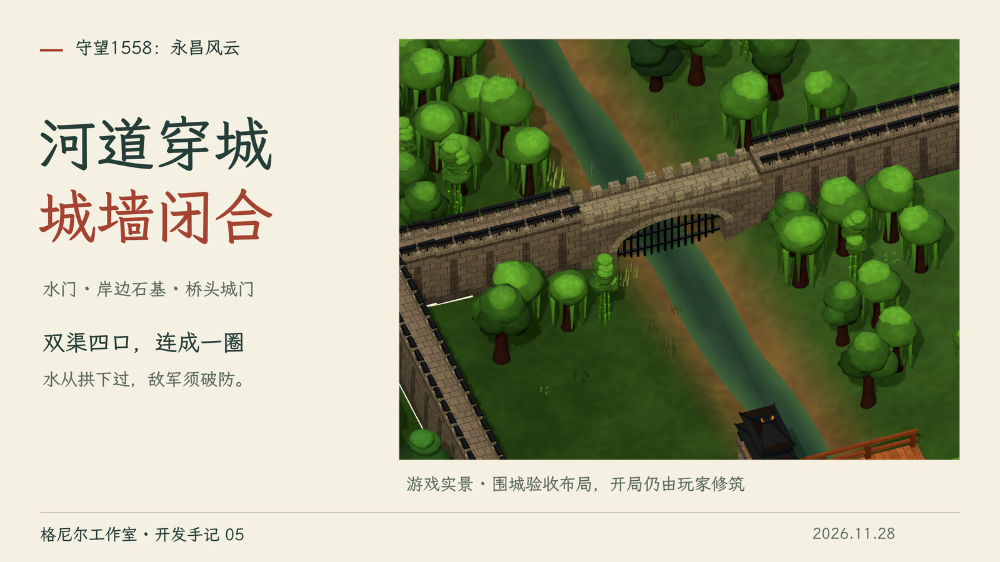

# 守望1558：永昌风云

国风低模海防筑城策略游戏。以永昌堡与英桥王氏的历史为创作背景，从四户村落出发，经营生产运输、筑城募勇、抵御海上来寇，并乘舟反攻岛寨。历史地理参照与玩法创作范围见 [地图说明](docs/yongchang-map.md) 和 [岛寨说明](docs/raider-island.md)。

[](docs/submission/devlog-05-water-defenses.md)

最新开发日志：[河道穿城，城墙终于合上了](docs/submission/devlog-05-water-defenses.md)（2026-11-28）。

2026 开源游戏开发大赛（OSGJ）「守·望」主题作品。参赛队伍：**格尼尔工作室**；队长及提交人：**三哒锅酱**。公开仓库：[AtomGit / yongchang-1558](https://atomgit.com/sanguodxj/yongchang-1558)。作品资料、封面、日志草稿及待发布链接见 [提交材料](docs/submission/README.md)。

## 从源码启动（评审入口）

1. 克隆上述仓库，并 `git checkout <官网登记的完整提交SHA>`。固定提交的源码是评审对象，根目录 `index.html` 保留作旧版对照。
2. 使用 Godot **4.7.2 标准版**打开 `game/project.godot`，等待字体、图标等资源首次导入。点击运行即可游玩；无须安装 Node、Python 或导出模板。
3. 使用 Dora **1.10.2.12 OpenGL 版（包含 Godot 支持）**打开项目根目录，运行 `init.lua`。入口会加载刚导入的 `game/` 工程。确认进入国画标题后点“步入永昌卫城”→“开始守望”；新手可选“新手准备”。

下载：[Godot 官方版本](https://godotengine.org/download/archive/) · [Dora SSR 官方发行](https://github.com/IppClub/Dora-SSR/releases)。Windows 命令行导入也可使用 `Godot.exe --headless --path game --editor --import --quit`。正式游戏不依赖本机 `D:` 盘路径。

固定提交 `2843e00f81fc557c39d7b36dad73762bd0ddb95f` 已从无缓存的独立克隆完成导入，并通过 Dora 源码启动、标题、开局和建造扣费检查；其后若修改游戏源码须重新复核。评审最终 SHA 以官网提交记录为准。

## Dora 与 H5 同步版本

正式版本只维护 **一份 Godot 4.7.2 工程 `game/`**。地图、模型、玩法、数值、UI、声音均在该工程内。H5 用 Godot Web 运行时，Dora 用 GodotNode 加载同一个 `game.pck`；构建时逐字节核对两个内容包，并在 `BUILD.json` 中记录 SHA-256。

2026-11-28的材质、步态、接地、单位避让、音效及三首Lyria配乐改动见 [精修记录](docs/visual-audio-crowd-polish.md)。`python scripts/check-polish.py --full` 可复查对应逻辑；性能及实机证据按各报告的源码/PCK哈希使用。

- **Dora**：在 Go 模式的“导入作品包”选择 `dist/Yongchang1558-Dora.zip`，或解压后在 IDE 运行 `init.lua`。需要含 Godot 支持、渲染后端匹配的 Dora SSR 1.10.2。此次实测为官方 OpenGL 版 1.10.2.12；另附字节相同的 `.dora` 扩展名副本。
- **H5**：完整解压 `dist/Yongchang1558-H5.zip`，以 HTTP/HTTPS 提供全部文件，打开 `index.html`。需要 WebGL 2；无需 CDN、Node 服务或跨源隔离头。
- **源码**：`dist/Yongchang1558-Source.zip`；两个运行包内部也各有一份 `SOURCE.zip`。游戏的“开源与授权”界面提供获取入口。

本地启动已构建的 H5：

```powershell
python scripts/serve.py --port 8767
# http://127.0.0.1:8767/
```

源码开发直接使用 Godot 4.7.2 打开 `game/project.godot`。生成两个平台应用包：

```powershell
python scripts/build-platforms.py --godot <Godot-4.7.2-console> --web-template <web_nothreads_release.zip>
```

详见 [运行与构建说明](docs/platforms.md)、[同源约束](docs/platform-contract.md) 和 [验收记录及限制](docs/platform-validation.md)。本地的 `.build/` 与 `dist/` 不入库。

## 山海地图

玩家可通过“营造 → 永昌城防 → 跨渠水门”连接河道两岸城墙，浅岸城墙自带石基，陆门可守住桥头。双渠可以完整围入城区；水门被击毁后恢复岸边缺口，水面不会变成陆桥。操作、花费与验收见 [跨渠城防](docs/water-defenses.md)。

石料与铁矿已改为嵌入山麓的风化岩露头，统一坡面配色，去除浅白尖石和鲜橙矿块；占地与采集通路经核对。见 [岩石与矿点修正](docs/rock-geology.md)。

植被已改为连续山地林、山麓林与平原林片，可玩地图约2,938棵树；保留桥头、村落和运输通路。分区树冠覆盖与验证方式见 [林地覆盖修正](docs/vegetation-cover.md)。

全图自然性审核已移除逐格石块、环岸芦苇墙及穿山海平面切槽。两支低地水道连续汇入海湾，山麓和岛坡由连续高程形成，植被按湿度/林群随机分布。地形限制、物体落地与全图分区画面见 [审核说明](docs/landscape-audit.md)。

开局地形除已有初始建筑与五座木桥外，不预置人造设施：无石砌护岸、铺设道路、田埂条垄、独立栈桥码头、停泊装饰船、灯杆或渔网。渡海从自然岸滩上下船；只有实际运输时生成船只。见 [自然开局约束](docs/natural-start.md)。

地图按“西部山脊—山麓林地—双渠村落与耕地—滨海湿地—虚构海岛”重建，参考《帝国时代 IV》先定地块/通路再雕刻和分层绘制的地图制作方法。史实确认、现代地形关系校验与玩法推定见 [地形设计](docs/terrain-design.md)。精确明代岸线未获测绘支持，不作为复原结论。

修改 `content/yongchang-map.json` 后运行 `python scripts/build-terrain.py`（Python 3.11+、NumPy、Pillow）；随后运行共同逻辑和几何检查，再构建两端。生成器保留既有建筑/人物模型，并复用一份地形高度用于渲染、行走、建造和地面拾取。生成器与素材源均包含在源码包中。

```powershell
python scripts/build-terrain.py
python scripts/test-common.py
python scripts/check-terrain.py
python scripts/build-platforms.py
python scripts/check-terrain-runtime.py --runtime <Dora.exe> --output .build/terrain-runtime
```

## 远海反攻

当前地图为 224×96，敌岛东移64格，渡口间距由7格增至71格。双重寨门、四座铳楼、两处岸防炮和5000耐久本营构成后期目标。自动进攻先在大陆渡口集结，再乘船出发；建议用包铁冲车、虎蹲炮车配合护卫。详细数值和验收见 [远海岛寨设计](docs/offshore-fortress.md)。

## 民丁与运输设施

民丁按工种持镰、斧、镐、勺、锯或锤，采集、加工分别使用对应工具。行走按位移落脚，工作包含蓄力、接触和收回，搬运物随双手移动；详见 [动作精修](docs/motion-polish.md)。“水乡民生”可建设2×2物资堆放场及独立绑牛桩；工人选择可达的最近堆场。采石场可独立工作，7格内配绑牛桩后每批石料产量+50%，由牛车运送，同一石场不叠加。详见 [工种、运输与模型修正](docs/worksites-and-animation.md)。

## 性能

保留当前画质与动作，减少重复骨骼求解，使用单位空间查询与对象索引。最新四轮原生对照中，125单位交战平均脚本耗时20.03→10.82毫秒；重战场仍未稳定60FPS。原生/H5的帧尾、内存和复现方法见 [性能报告](docs/performance.md)，其中区分压力夹具、真实输入和共享机器负载。

## 界面风格

两端共用“永昌海防图志”国风 Q 版界面：楷书题签、浅绢纸册页、朱印、青绿选中态和木刻线描图标。封面以原代码画作参考，经图生图重绘为青绿国画，标题与按钮由游戏单独绘制。营造与募勇卡牌保留实际模型画像，宗族与军令按需展开，并提供资源与阶段目标定位。详见 [UI 风格与来源](docs/ui-style.md)。

## 操作

开局、生产、防守、渡海、胜负与重开的实际验收，以及手机尺寸等剩余问题，见 [玩法闭环与易用性检查](docs/gameplay-usability.md)。

- 营造：选卡后显示建筑轮廓、占地网格与阻挡原因；左键放置，城墙、油壕支持拖线；`R` 转向，右键或“取消”退出。没有隐形东侧禁建线；岩石、自然河岸、芦苇湿地、水面、树木与矿藏直接显示限制。缓坡用可见地基承接。
- 募勇：六类兵种共用资源与人口规则。左键选择、拖框选择多支小队，`Shift` 增选，双击选择屏内同类；右键移动/攻击，`Shift` 右键排路点，`S` 停止，`A` 后左键攻击移动。鸟铳小队可驻防城墙或敌台。
- 编队：`Ctrl+0..9` 保存当前选择，数字召回，连续按两次定位；`H` 回宗祠，空格定位所选。
- 渡海：在右下“军令”选择“进攻”，令部队向渡口集结并乘舟反攻，也可直接命令部队前往对岸。
- 宗族：点击左上“宗族”进入“驻祠”、三种乡约、“义捐”（每局两次）、“驰援”（每局一次）；开田、筑堡与守夜解锁加成。
- 镜头：右键短按下令、拖动平移；中键拖动、屏幕边缘/方向键也可平移。滚轮缩放，`Q/E` 旋转，`M` 全图；小地图点击/拖动定位、右键下令。`A/S` 用于攻击移动/停止。
- 触屏：单指拖镜头，点部队后点地调遣；点“框选”后拖出选框，选中后可停止、攻击、追加路点或取消。营造先点地面/拖线预览，再点“确认营造”；双指平移/缩放，地图面板可旋转。输入按实际触摸/鼠标识别，窗口尺寸只决定布局。浏览器触控模拟已覆盖，真实手机设备仍需单独验收。详见 [两端操作修复](docs/input-repair.md)。
- `Esc` 先收起当前面板、取消营造或选择，再暂停。暂停中按`Esc`直接恢复；可保存进度并返回标题，下次继续守望；胜负结算可直接“再守一局”。

## 项目结构与验证

| 路径 | 用途 |
| --- | --- |
| `game/scripts/session.gd` | 两个平台共用的玩法状态机 |
| `game/scripts/unit_rig.gd` | 人物骨骼、工种工具及行走/工作/战斗动作 |
| `game/scripts/main.gd` | 共用画面、镜头、键鼠/触控与只读状态观察 |
| `game/scripts/mobile_ui.gd`、`game/assets/ui/` | 共用国风 Q 版 UI、册页皮肤、原有模型画像与线描图标 |
| `game/scripts/assets.gd`、`game/assets/` | 原程序化模型与地图的无损导出、统一加载 |
| `game/shaders/`、`game/scripts/sound.gd` | 共用材质、水面与合成音效 |
| `init.lua` | Dora 宿主入口，加载同一 Godot 工程/PCK |
| `scripts/build-platforms.py` | H5、Dora、完整源码归档与校验收据 |
| `scripts/test-common.py` | 共同逻辑测试；战斗用测试军队，不代表正常经济通关 |
| `scripts/check-h5.py` | 已导出 H5 的真实输入、触控模拟、实际响应哈希检查 |
| `scripts/check-dora.py` | Dora 宿主加载、桥接输入、实时状态与截图 |
| `src/`、`vendor/`、根目录 `index.html` | 旧 Three.js 版与资产生成器，保留供迁移对照，不作为正式 H5 入口 |
| `scripts/migrate-assets.py` | 从旧版实际构造器导出模型、地图和数据 |

```powershell
python scripts/test-common.py
python scripts/check-worksites.py
python scripts/check-model-clearance.py
python scripts/check-fortress.py
python scripts/check-fortress-runtime.py
python scripts/check-h5.py --output .build/h5-check
python scripts/check-dora.py --runtime <Dora.exe> --output .build/dora-check
python scripts/check-ui-parity.py --runtime <Dora.exe> --output .build/ui-parity
```

H5 检查前先启动静态服务；Dora 检查前启动对应宿主。旧版对照服务使用 `python scripts/serve.py --directory . --port 8766`。完整来源与生成参数保留在源码包内。

## 授权与参赛

当前代码为 [AGPL-3.0-only](LICENSE)。团队原创且有权授权的非代码资产为 [CC BY 4.0](https://creativecommons.org/licenses/by/4.0/)，允许署名后的商业使用、修改及再分发，并须标明修改。范围与署名见 [ASSET_LICENSE.md](ASSET_LICENSE.md)。第三方字体、Godot、Three.js 保持原许可证，见 [THIRD_PARTY.md](THIRD_PARTY.md)。此前 MIT 版本的既有授权保留。

源码已公开于 AtomGit。已适配 Dora 的作品可按固定提交的源码参评；公网 H5 与发行包用于方便试玩。正式提交须在赛事官网个人中心完成，不能以原子派投稿代替。按提交人提供的个人中心信息，作品提交计划于 **2026-11-28 23:59（北京时间）**开放，截止仍按官网公布的 **2026-12-06 23:59**准备。提交后须完成规定互评；申请 Dora 开源社区奖另需在公示截止前获得原子派至少20赞并通过相关审核。

## AI 使用情况与素材来源

AI 辅助参与了代码、程序化模型、移植、测试、文档及展示材料制作；本项目不将AI输出声明为全部由人工逐行编写或逐笔绘制。

| 工具/来源 | 实际用途与生成内容 | 人工决策、修改及复核情况 |
| --- | --- | --- |
| OpenAI Codex（当前接续为GPT-6） | Godot/Dora/H5移植与维护、工种/动作修正、性能诊断、测试脚本、文档及提交材料辅助 | 队长提出需求并反馈模型重叠、动作物理逻辑、工种工具、设施关系和性能问题；代理据此迭代，并保留自动检查和运行记录。没有据此宣称已完成人工逐行审核、全部动作观看或声音听审 |
| Gemini `gemini-3-pro-image`，经本地AIStudio2API调用 | 以项目代码绘制的封面为参考，生成国画标题背景，并进行第二次纸色接缝修复 | 最终生成PNG原样保留；标题和按钮由程序绘制。参赛封面另以脚本裁为1600×900并排入作品名和团队名。提示词、输入图、阶段图和哈希见 `content/cover-generation.json` |
| Lyria `lyria-3.5`，经本地AIStudio2API / build-music 调用 | 三首器乐配乐：《乡土晨炊》《烽堠守望》《破浪归航》，分别用于经营、夜间守望和反攻 | MP3 原始字节完整保留，没有裁切、归一化或滤波；游戏内控制音量并淡入淡出。完整提示词、时长和 SHA-256 见 `content/music/manifest.json`；尚未获得人工听审确认 |
| 项目程序化生成器 | 建筑、人物、船只、植被、地形、图标、皮肤，以及游戏内合成音效 | 生成器及调整记录公开；没有把模型与音效的代码生成过程冒称为手工建模或人工录音 |

第三方来源为 Godot、Dora SSR、Three.js、Sarasa Gothic 与霞鹜文楷，作者、许可链接、使用范围和许可全文见 [第三方清单](THIRD_PARTY.md)。项目原创代码/资产的授权边界见 [资产授权](ASSET_LICENSE.md)。史料用于背景研究，未捆绑史料网页照片；虚构海岛、海程和战斗数值属于玩法设计，不主张精确历史复原。

**赛前内容声明待补全：** 已确认使用的第三方引擎、库和字体均属既有工具/资源。仓库首条提交在2026-11-25，但该日期不能证明所有自有内容都始于赛期；队长尚需确认赛前自有代码/素材清单、其他成员分工，以及此前使用的其他AI工具。未确认项不按“没有使用”处理。具体待补字段见 [声明核对表](docs/submission/declarations.md)。
