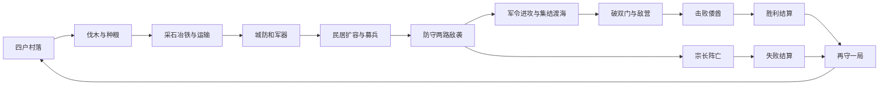

# 玩法闭环与操作易用性检查

2026-11-27，检查对象为正式Godot工程及实际H5、Dora导出包。结论：经营、防守、渡海、破营、击败倭酋、结算与重开均有可达路径；桌面操作中的明确断点已修复。手机尺寸的易用性仍不合格，尚不能把脚本通关视为新手试玩通过。

## 闭环与证据



修复前PCK `560a0730e2631993c5f930720b1ccc779e1c498905e6474cacd92a3fe35f4c4d` 已用真实鼠标键盘完成一局：25次建设、19次付费招募，349.87秒反攻、466.97秒胜利，45人登陆。说明玩法可完成，但原界面没有给出足够的建设顺序和胜利条件提示。

修复版PCK `059017807a018269939be6f79ad899bf28183d0d562764c4593f4a9cbf183683` 的实际输入验证：

- 正常经济开局：25次建设、19次付费招募，351.10秒反攻、466.17秒胜利，45人登陆、359批运输完成；随后通过“再守一局”直接回到新局，资源和部队重置。
- 被动防守：不建设、不募兵、不义捐，仅使用正式2×速度；184.47游戏秒宗长阵亡，结算说明失败原因，再守一局恢复宗长1550生命、初始资源与1×速度。
- 两条路径均未写入游戏状态、注入资源或赠送测试军队。胜利路线使用正常游戏允许的两次义捐和一次驰援，由脚本准确执行已知策略；不代表平均玩家难度。
- 共同玩法109项、岛寨14项、易用性规则25项通过。H5输入专项16项通过，包括卡牌翻页、触控到达最后一张民生卡、招募反馈、模式互斥、菜单快捷键隔离、取消返回和确认重开。
- H5既有键鼠/触控模拟检查与Dora原生16项操作检查通过。双平台12界面、H5四种窗口配置另行复核，最终状态以 `dist/VALIDATION.json` 为准。

## 发现并修复

| 优先级 | 原问题 | 改动与验收 |
| --- | --- | --- |
| P1 | 选建筑后打开募勇，旧放置模式仍生效，下一次点地面可能继续营造 | 切换卡牌面板清除放置及预览；实际鼠标与规则检查通过 |
| P1 | 暂停、说明页仍响应转镜头、速度、军令等战场快捷键 | 非游玩画面只处理返回/恢复；暂停、说明、标题、确认、胜负六种状态逐项检查 |
| P1 | 招募把即将转为士兵的乡民重复计入总人口，容量刚好足够仍拒绝 | 按 `现有人口−消耗乡民+新增士兵` 检查；2乡民转4士兵、上限4时成功；上限3时拒绝且不扣费 |
| P2 | `Esc` 在卡牌列表直接暂停，操作层次不明确 | 先关闭说明/确认、宗族/军令、卡牌或放置模式，再取消选择，最后暂停；暂停内直接恢复 |
| P2 | 首夜折扣生效后，卡牌仍显示原价；失败只给笼统信息，仍播招募成功音 | 显示与扣费共用价格；明确缺少哪项资源/乡民/丁口，成功后才选中新队伍并播放成功音 |
| P2 | 民生末尾卡牌只能找细小滚动条，触屏难以发现 | 加入上一页/下一页按钮，保留拖动；真实点击与触控到达民居卡并进入放置 |
| P2 | 开局与远征缺少下一步目标，破敌营与真正获胜易混淆 | 左侧边缘显示随真实状态变化的阶段提示；选建筑时显示作用与放置说明；明确敌营被破后仍需击败倭酋 |
| P2 | 失败/胜利界面仅有通用菜单，缺少原因、成果与直接重玩 | 显示用时、建设、运输、登陆以及失败原因；胜负两条真实路径均验证直接再开一局 |
| P2 | 暂停菜单一次点击返回标题就丢失当前局 | 增加明确的进度丢失说明和取消/确认；取消保留暂停状态、资源、军队与时间 |
| P2 | 水面放置失败无反馈，开局建筑拆除预览和实际拒绝不一致 | 放置统一走规则错误反馈；不可拆初始建筑明确提示，费用保持不变 |
| P2 | 帮助页返回回调持有界面自身，重载后的引用未清理 | 场景退出释放回调；当前无头检查完成后无该对象/资源泄漏日志 |

生产、地形、兵种伤害、敌袭强度及海程未为通过检查而调低。卡牌说明改为与当前实现一致：绑牛桩让石场每批6石增至9石，牛车最多载12石；油壕需主动引火，并会伤及友军，不再暗示尚未实现的自动火箭联动。

## 尚未解决或尚未验证

| 优先级 | 项目 | 观察与下一步验收 |
| --- | --- | --- |
| P1 | 手机布局与触控尺寸 | 844×390下最小按钮约18.7 CSS像素，390×844下约11.7像素；低于44–48像素触控目标，文字同步缩小。需要独立紧凑布局与真实Android/iOS验证，不能仅缩放固定画布 |
| P2 | 矿点、路线与生产状态的可发现性 | 小地图只有建筑/部队标记，没有石矿、铁矿、油泉图例或目标导航；工坊不能点选查看完整等待原因。阶段提示改善顺序，但仍需更直接的资源定位和工坊状态查看 |
| P2 | 新手平衡与策略多样性 | 只证明一条熟练脚本策略能赢，以及完全不行动会输；未完成三种水平玩家、多路线的人类试玩。不能据此宣称难度适中 |
| P2 | 存档与中途恢复 | 当前没有存读档。返回标题有确认，但刷新/关闭页面仍会失去本局；约8分钟的对局需要评估断点恢复 |
| P2 | 供粮反馈 | 缺粮会阻止乡民归附，军队不会直接因饥饿受损；是否符合预期属于平衡决策。缺乡民时已提示粮食/容量恢复条件；工坊等待原料的状态说明仍可更细化 |
| 未验收 | 声音、手柄与真实手机性能 | 音效只核对调用和开关，无人完成实际听审；未实现完整手柄导航，桌面触控模拟不证明真机手感/性能 |

## 复现与证据

```powershell
python scripts/check-usability.py
python scripts/check-usability-runtime.py --output .build/usability/input
python scripts/check-usability-loss.py
python scripts/check-fortress-runtime.py --output .build/usability/fortress/live-economy
python scripts/check-h5.py --output .build/usability/h5-check
python scripts/check-dora.py --runtime .build/dora-opengl/Dora.exe --output .build/usability/native-check
python scripts/check-ui-parity.py --output .build/usability/ui-parity
```

`before/input/report.json` 在修复前实际复现了四项失败；`rules/` 为规则/界面状态验证，`input/` 为真实输入和小屏截图，`live-defeat/` 与 `fortress/live-economy/` 为失败和通关。均位于 `.build/usability/`，不打入运行包。当前测试用状态观察取自实际游戏，只读；控件重建后须等待布局更新，不能使用过早的按钮坐标当作点击失败证据。

双端12界面×4窗口最终匹配。首次Dora对照在容器尚未完成布局时读取到中间哈希；改为6秒上限内要求两次连续匹配，并记录等待时间后复验通过。未更改游戏状态或放宽矩形匹配条件。
