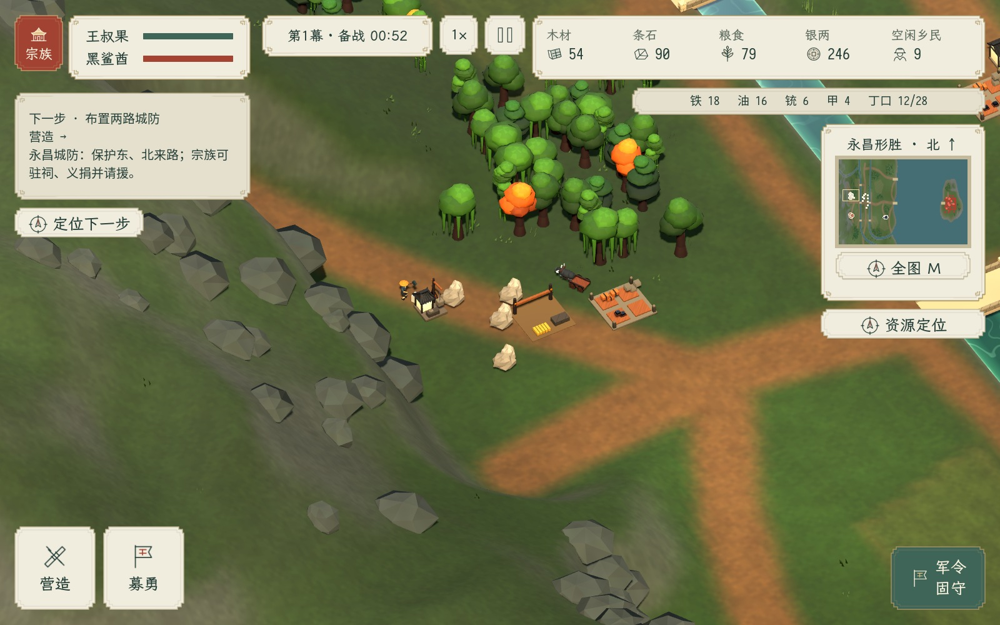

# 开发日志草稿二：民丁不是摆件

发布状态：待队长核对并公开发布。署名：格尼尔工作室 · 三哒锅酱。建议配图：采石与牛车实际画面、动作关键帧矩阵。

这一轮最直接的反馈是：模型有重叠，单位缺少可信的骨骼动作，不同工作的民丁应该拿不同的工具。第一版让骨骼动起来之后，又出现了新的问题——有动作，仍然不符合物理直觉。

我们随后把注意力放到接触关系上。人脚不应跟着整个人物一起在地面滑动；斧和镐需要有准备、接触和收回的过程；双手握持时，两只手要跟随同一件工具。搬运的物资也应该跟着双手移动。牛马的腿部、牛车车轮以及船上乘员的支撑同样需要分别处理。

当前人物采用15骨骼结构，行走根据实际位移推进步态，工作按工种及阶段使用镰、斧、镐、锯或锤。车轮角度根据行驶距离变化，乘船支撑随甲板更新。为了验证这些关系，检查脚本直接读取骨骼和接触位置，再结合关键帧与实际工作画面复核。

设施也调整了分工。采石场本身可以独立生产；绑牛桩作为单独可建的设施，在7格内配对一座可达的石场，使每批石料从6增加到9，并派牛车实际运输。这个增产不会重复叠加。堆放场是2×2的可建设施，选址会影响工人选择的可达入库地点。

当前实际运行检查中，牛车完成了9石入库，采石、种粮和伐木的工具与骨骼姿态持续变化；暂停后工作动作保持不变。模型净空与动作接触还有独立检查。我们保留了这些数据，也保留边界：这不是“所有地形、所有攻击帧永远零穿插”的保证。

这次迭代让经营链条更容易被看见：玩家能从工人的工具、动作和运输方向理解生产进展，而不只是在资源栏里等待数字增加。

项目：<https://atomgit.com/sanguodxj/yongchang-1558>

本篇由AI协助根据实际修改与验收记录整理，需队长核对后发布。建议话题：#2026开源游戏开发大赛 #守望1558 #游戏动画 #游戏开发日志
