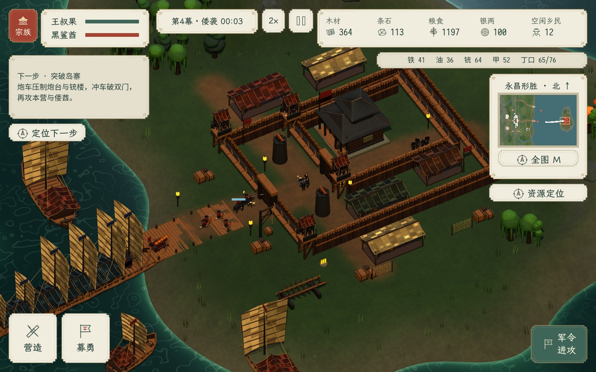

# 开发日志草稿三：优化不能只看平均帧率

发布状态：待队长核对并公开发布。署名：格尼尔工作室 · 三哒锅酱。建议配图：性能对照图、岛寨实际画面。

这次性能工作从测量开始。我们给Godot主循环增加可关闭的分段观察，把模拟、镜头、画面同步和HUD分别计时，再观察引擎的渲染回调间隔。计时期间不截屏，也不同时跑构建和其他验收。

最明显的重复成本出现在骨骼和单位查询中：相同姿态被反复求解，没有变化的变换仍然写入场景树，单位避让还在进行大量不必要的配对。随后缓存静态骨长和索引、复用已收敛的静止姿态、跳过相同变换，并用空间桶缩小避让候选范围。

为了避免“少画了东西所以更快”，对照版本保留同一套模型、画质、单位数量和镜头。两版以A/B/A/B顺序采样，并核对起止完整模拟数据，包括单位、路径、生命值和计时器。36组避让差分场景还逐步对照原算法，检查配对顺序和推开结果。

在i5-12400F、RTX4060Ti的共享机器上，125单位交战夹具的平均脚本耗时从20.03降至10.82毫秒，约减少46%；暂停场景减少约86%。但我们没有把这写成“稳定60帧”：交战整帧P95仍为35.99毫秒，且绘制调用超过6300次。浏览器也出现过共享CPU满载时的长帧，短期重开观察尚不能证明长期内存稳定。

Dora与H5现在使用同一份Godot工程和同一个PCK内容包。除了对哈希，还分别验证标题、建设、募勇、暂停、UI和触控输入；正常经济路线完成了渡海通关，存档恢复也在真实路径中检查。

这轮得到的是可复核的成本下降，以及明确留下的下一步：普通设备、长时间运行和新手试玩。完整原始统计方法、脚本和限制都写在仓库文档里，欢迎按同样场景复测。

项目：<https://atomgit.com/sanguodxj/yongchang-1558>

本篇由AI协助根据实际测试记录整理，需队长核对后发布。建议话题：#2026开源游戏开发大赛 #守望1558 #Godot #性能优化 #游戏开发日志
