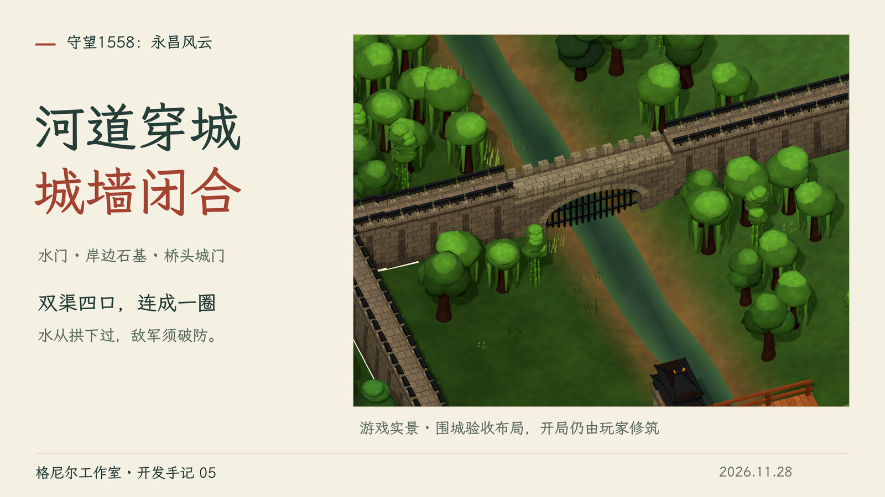
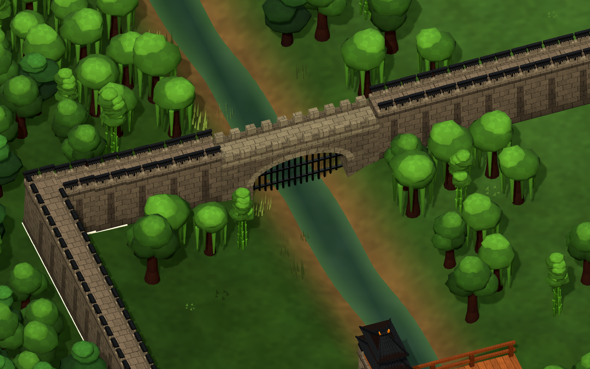
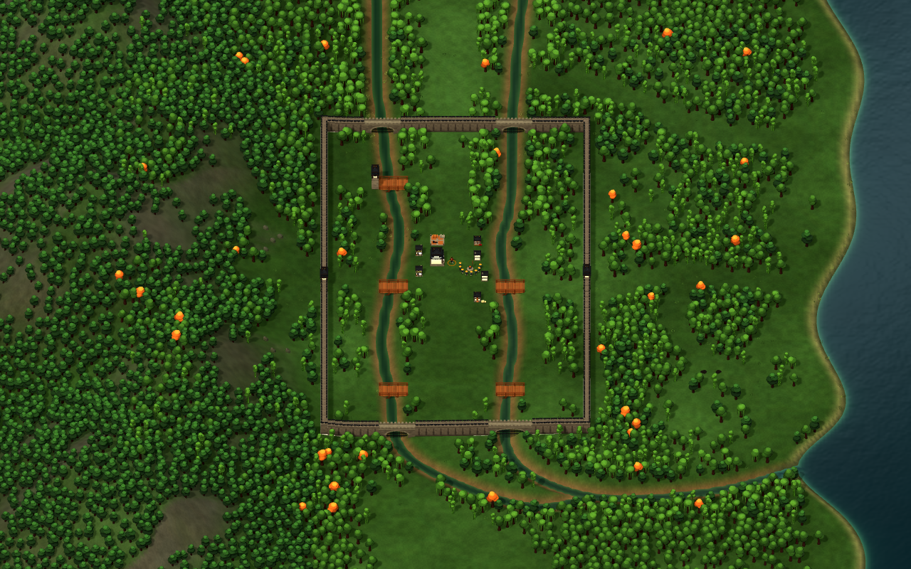

# 河道穿城，城墙终于合上了

今天给《守望1558：永昌风云》补上了一块很关键的拼图：水门。

起因是一个很直接的问题：敌军会走桥过河，可河上又不能建城墙，那最后修出来的城区，岂不是到处断口？

检查之后发现，问题确实存在。两条内渠从村落穿过，普通城墙遇水就停，部分河岸还“能走、不能建”。即使墙看起来已经接近水边，敌人仍可能沿岸绕进去。

这轮把三个地方一起接上了。

水面上，新增跨渠石拱水门。选中内渠后，预览会延伸到两侧干地。上面接城墙，下面留流水洞口，铁栅封住岸边通路。每座花费石16、木4、铁2，需要玩家自己修。

河岸上，适合的浅岸可以修带石基的城墙，不再被一条隐藏的禁建边界拦住。乡桥两头可以设城门，让民丁、步兵和冲车正常进出。

完整围起来以后，两渠仍在城里流，五座乡桥仍连接街区。敌军要从外面进来，就得攻破城防；水门被毁，岸边会重新出现缺口，河水也不会突然变成能走的地面。

这张完整围城图是提供建材、清理墙线树木后搭出的验收布局。实际开局仍是四户村落，外围的墙和门都得靠经营一点点建起来。

本轮42项城防专项检查通过，也跑了原有生产、战斗、海运与存档回归。Dora和H5都用真实点击建成了水门，H5还验证了触屏模拟和保存后重新载入。

“从村落建成一座城”终于有了更完整的落点：河流可以穿城，城防也可以闭合，城里的生活和城外的战斗都能继续发生。

格尼尔工作室 · 2026年11月28日

#独立游戏 #游戏开发日志 #国风游戏 #城建游戏 #模拟经营 #Godot #守望1558 #2026开源游戏开发大赛

---

本篇随源码公开。小红书竖版封面与可复制正文见 [发布素材目录](../../content/submission/water-defenses-20261128/)；社媒发布链接尚未登记。

封面使用本轮游戏实景重新排版，字体沿用项目的霞鹜文楷，没有新增图像生成。图像来源、裁切与哈希见 [封面收据](../../content/submission/water-defenses-20261128/cover-receipt.json)。正文由AI协助按源码与验收记录整理。水门形制是玩法设计，不宣称历史建筑复原。

可复核的 [验收快照](evidence/water-defenses-20261128.json) 对应内容包 `d54f2fc23077b7d6e6df0d0111b146edfcfce7c6ec9c845d16fee983151e32c2`：城防42/42、共同玩法110/110、指令11/11、存档19/19；Dora真实输入4项、H5桌面与触屏模拟12项。触屏模拟不代表实体手机性能，完整围城夹具不代表正常经济通关。

项目：[AtomGit](https://atomgit.com/sanguodxj/yongchang-1558) · [GitHub](https://github.com/sanguodxj-byte/yongchang-1558)。规则与复现命令见 [跨渠城防](../water-defenses.md)。
